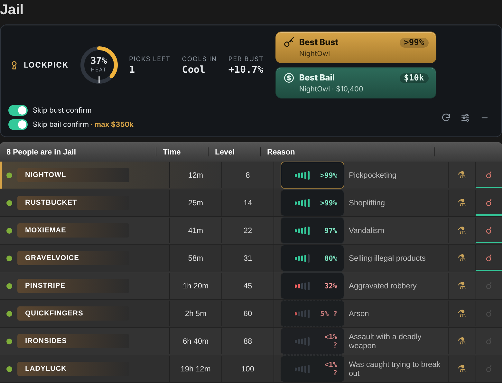
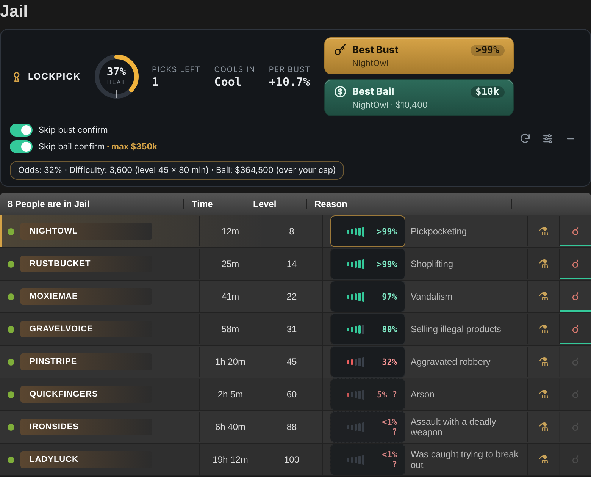
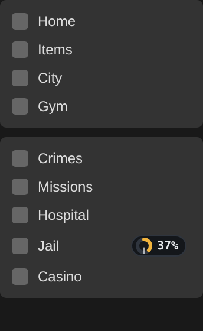
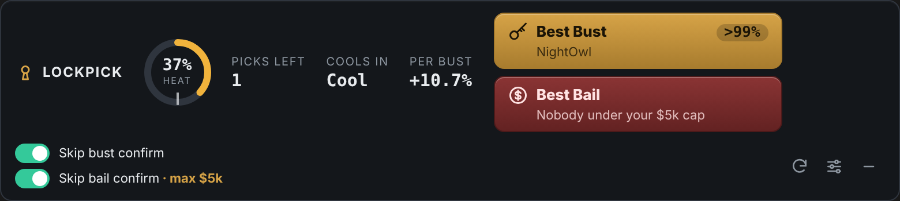
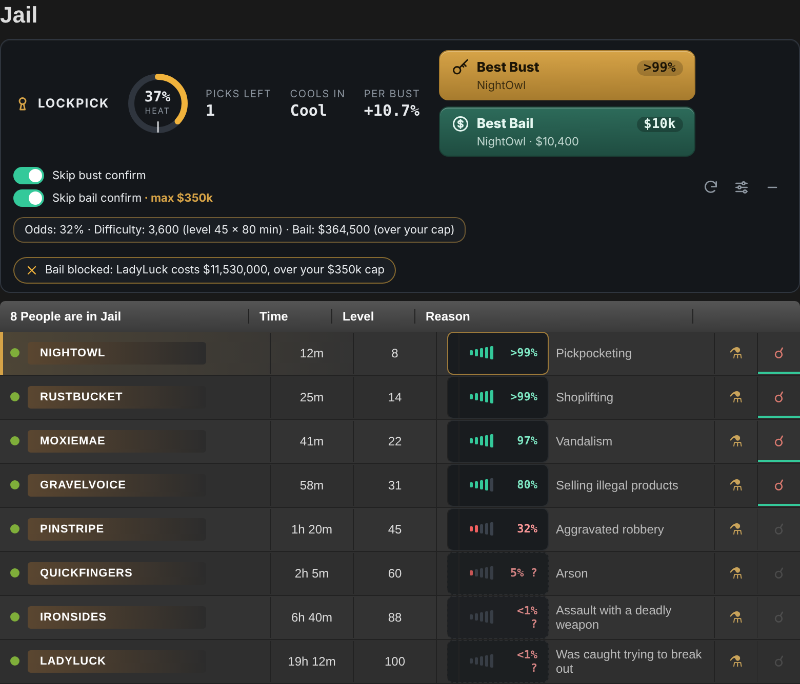
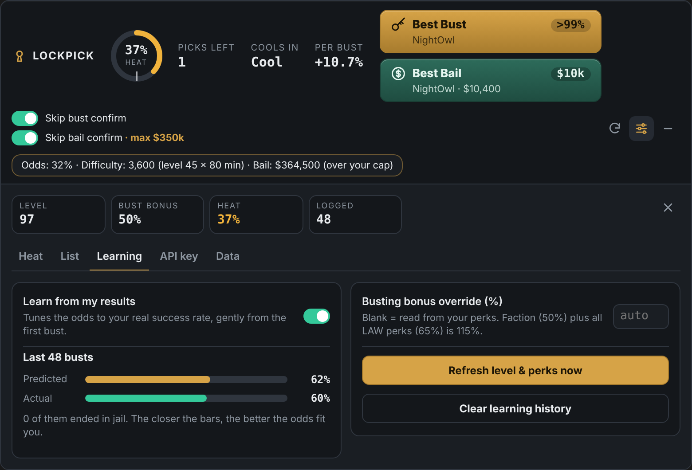
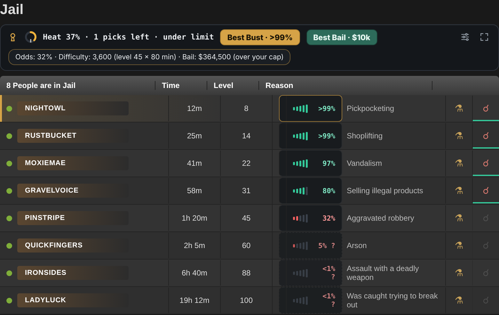
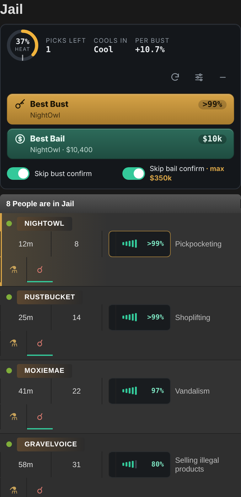
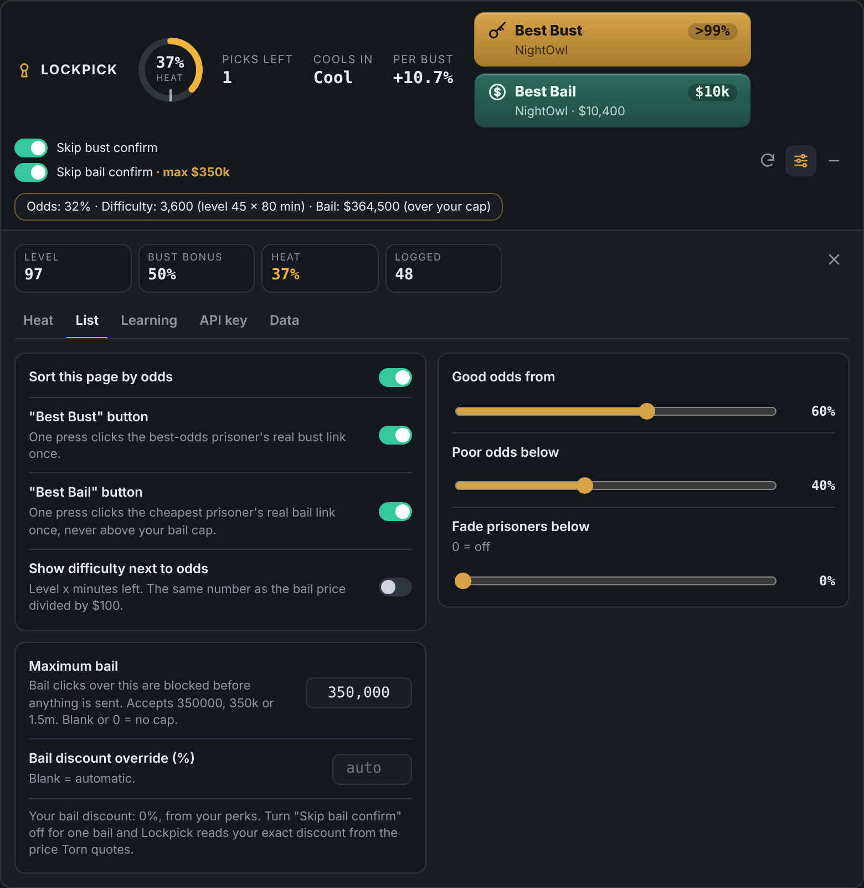
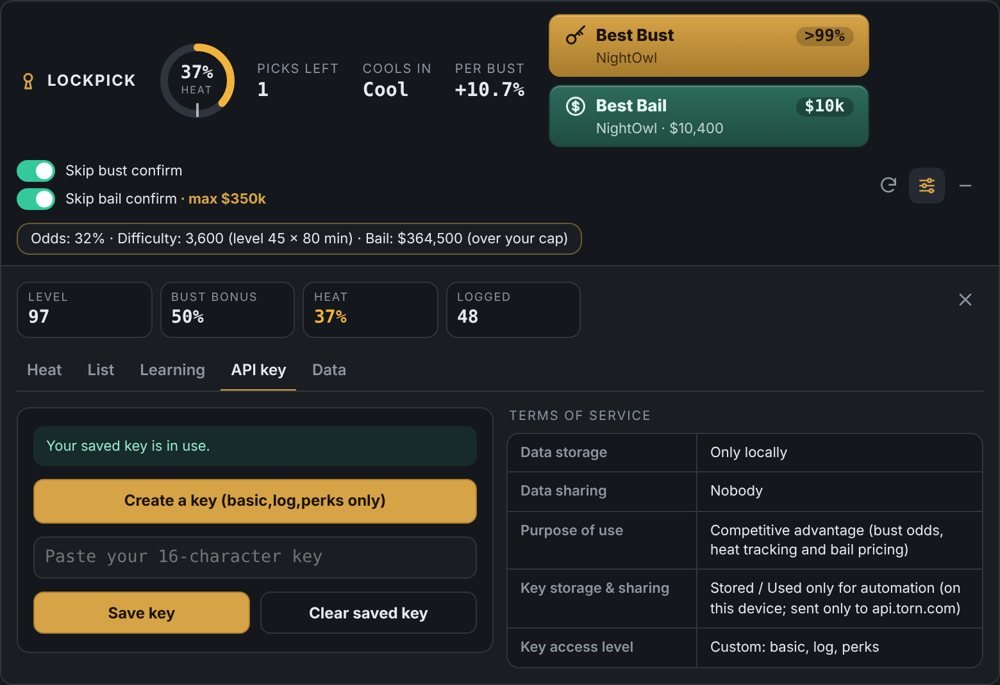

# Lockpick: Jail Bust HUD

A heads-up display for busting and bailing in [Torn](https://www.torn.com). Lockpick shows your odds on every prisoner, tracks your bust penalty as **heat**, prices every bail exactly, and gives you one-press **Best Bust** and **Best Bail** buttons, all inside the jail page.

Works in **Tampermonkey**, **Violentmonkey** and **Torn PDA**.

## Install

1. Install [Tampermonkey](https://www.tampermonkey.net/) (desktop) or use [Torn PDA](https://github.com/Manuito83/torn-pda) (mobile).
2. Open **[lockpick.user.js](https://raw.githubusercontent.com/Eaglewing91/Lockpick/main/lockpick.user.js)** and click **Install**. In Torn PDA, add it from the userscripts section of PDA's settings.
3. Open the jail page, click the settings icon in the Lockpick panel, and go to **API key**. Use **Create a key** to make one with only the access Lockpick needs, then paste it in. Torn PDA users can skip this; PDA's own key is used automatically.

Tampermonkey installs updates automatically.

## Features

### Odds on every prisoner
Each prisoner gets a signal meter and a success percentage. The best target is outlined in brass, and the page can be sorted by odds.

Odds are based on **difficulty = level × minutes left**, the same unit Torn uses for bail. Your busting bonus from perks and your current heat are factored in. Prisoners far harder than anything you've busted before are marked with a dashed outline and a **?**.

Tap or click any meter to see its details:

### Heat
Heat is your estimated bust penalty from recent successful busts, read from your Torn bust log. Each bust adds a share that halves after about 10 hours and disappears after 72. The panel shows:

- **Heat**, with a ring gauge and a tick at your heat limit
- **Picks left** before you pass your limit
- **Cools in**, the time until you're back under it
- **Per bust**, how much heat one bust adds at your level

A small heat badge also sits next to **Jail** in Torn's menu.

### Best Bust and Best Bail
- **Best Bust** clicks the bust link of the prisoner with the best odds. It turns green when that prisoner is 80% or better.
- **Best Bail** clicks the bail link of the cheapest prisoner within your bail cap, showing the exact price. It turns green when someone is within your cap, and red when nobody qualifies.

Each press is one click on Torn's real link, and only a real click or tap counts. Nothing repeats or runs on its own.

### Refresh
The slim **Refresh** button between Best Bust and Best Bail updates the prisoner list without reloading the page: new prisoners appear, released ones disappear and times update. Each press asks Torn once for the jail list you're viewing, exactly as the jail page does when you change page. A second press within a second is ignored.

### Exact bail prices and a bail cap
Torn charges **$100 × level × (shown minutes + 1)**, minus any bail discount. Lockpick shows that exact price on every prisoner. Set a **maximum bail** and any bail click over it is blocked before anything is sent.

Your discount is read from your perks, learned from the price Torn quotes when you bail with confirmation on, or set manually.

### Skip-confirm switches
**Skip bust confirm** and **Skip bail confirm** make your own click go straight through without Torn's "Are you sure?" step. You still click every bust and bail yourself.

### Learning
Lockpick logs each bust you make and gently adjusts the odds to your real success rate, starting from your first bust. The Learning tab compares predicted and actual success over your last 100 busts.

### Compact view
Shrink the panel to one slim strip when you just want the essentials.

### Phones and Torn PDA
The panel rearranges for narrow screens, buttons are larger, and details open with a tap.

## Settings

| Tab | What's there |
|---|---|
| Heat | Heat limit, nav badge |
| List | Sorting, Best Bust and Best Bail buttons, odds colours, fading, difficulty display, maximum bail, bail discount |
| Learning | Learning on/off, accuracy, busting bonus override, refresh level and perks |
| API key | Key status, create/save/clear key, terms of service |
| Data | Erase all Lockpick data |

## Terms of service

| | |
|---|---|
| **Data storage** | Only locally |
| **Data sharing** | Nobody |
| **Purpose of use** | Competitive advantage (bust odds, heat tracking and bail pricing) |
| **Key storage & sharing** | Stored / Used only for automation (on your device; sent only to api.torn.com) |
| **Key access level** | Custom: basic, log, perks |

## Compliance with Torn's scripting rules

- **Torn API, plus one request per Refresh press.** Lockpick's automatic requests go only to `api.torn.com`: your bust log every 60 seconds while the jail page is open, and your level and perks once a day. Nothing is fetched on other pages. The only other request is when you press **Refresh**: one press = one request for the jail list you're viewing, never automatic and at most one per second. If the list isn't on the page, Refresh reloads the page once instead.
- **One click = one request.** Best Bust and Best Bail each click one real link on the page you're viewing, and Torn's own handler sends the request. Only real clicks count, and each button pauses for a moment after a press. There are no loops, timers or queues.
- **Skip-confirm** only rewrites the link you clicked, at the moment you click it.
- **The bail cap** only stops clicks; it can never send anything.
- **Reading pages** is limited to the jail page you have open and the Jail link in the menu.
- **No external servers, no WebSockets.** All data stays on your device.

## How accurate is it?

Torn doesn't publish its busting formula. Lockpick's odds start from community-tested limits and improve as you bust. Heat uses a community model that only counts successful busts. Bail prices are exact.

## Credits

Made by **Eaglewing**.

The heat (bust penalty) curve constants are adapted from **BUSTR** by Adobi, Ironhydedragon and The_Baron, used under the MIT licence. The odds model, interface and everything else are original to Lockpick.

## Licence

[MIT](LICENSE)
